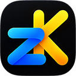

<p></p>

# Znimok

[Українська](README.md) · **English**

> **Preview version 0.0.33.** Znimok is in development: features arrive with every update, the code and the plan are changing.

Screenshots for Windows and macOS with an editor that keeps marks editable: an arrow, a caption or
a hidden area can be adjusted a week later. Shots live in a library on your computer, in their own
open format; the result goes to the clipboard, to a file, to a chat or an issue through "Send to…",
or straight to an AI agent.
Screen recording is in preview: with sound, the cursor, the browser's DevTools log (and dataLayer),
export to MP4, GIF and HTML and a developer report. The library can be searched by the text on screenshots too.

Znimok succeeds the screenshot and video features of [Little Helpers](https://github.com/V-Plum/lilhelpers):
the same experience, but new code in Rust, two operating systems, an installer and a modern
interface. Little Helpers files are not compatible — the features move over, not the format.

**[Download →](https://v-plum.github.io/znimok/en/)** · [Guide](docs/guide.en.md) ·
[Keys](docs/SHORTCUTS.en.md) · [Privacy](docs/privacy.en.md)

## Features

- **Capture** a region, a window (without what covers it) or the whole screen, across several
  displays, with a loupe, a 3-2-1 countdown, scrolling capture of long pages and reading of QR
  codes and barcodes. Correct exposure in HDR. Znimok's own windows can step aside for a shot or
  stay in the picture.
- **Text from the screen**: X on the overlay (or a hotkey of its own) puts a region's text on the
  clipboard; recognised on the device, with no AI and no internet.
- **Three release actions** — into the editor, straight to the clipboard and the library, or edit
  right over the screen; what each gesture does can be reassigned.
- **Editor**: rectangles and ellipses, lines with arrowheads, pen, text, hide (pixelate, blur,
  plate), highlighter, counters, stamps and emoji, pictures, crop, rotation, tone; any colour with
  an eyedropper; groups, layers, turning marks; text from the shot; every action undoes.
- **Library** with thumbnails, search (optionally by the text on screenshots too), date groups,
  pins, the keyboard, picking several cards and a trash (restore / destroy); the folder may live
  on a cloud drive. Every document opens in a window of its own — shots can be compared side by
  side and marks dragged between them.
- **Video (preview)**: record a region, a window or the screen on Windows and macOS with system
  sound and the microphone, the pointer and clicks; playback on the graphics card (forwards,
  backwards, 0.5–2×, thumbnails on the strip); trimming and cutting; marks that appear in their
  own time; a frame as a screenshot of its own. Export to MP4, GIF or an HTML page; an untouched
  recording is copied as is, without re-encoding, and an MP4 starts playing in a browser before
  it has fully downloaded.
- **Developer report**: the extension for Chrome, Edge and other Chromium browsers writes the
  DevTools log while you record — console, errors, network, navigations, dataLayer. The report is
  one HTML page or a `.zreport` archive: the video with its marks and the log beside it, following
  the video; sensitive values (tokens, cookies, e-mail) are hidden on export.
- **Share**: copy, drag into a chat, export to PNG/JPEG/WebP with metadata. **"Send to…"**
  (experimental) — Google Drive and Gmail, Telegram, Jira, Slack, Redmine or a webhook (n8n,
  Zapier, Make); tokens stay in the system's secret store.
- **For agents**: an MCP server, the `znimok` command and a "Hand to agent" button — capture, read
  the library, edit documents and recordings (off until you turn it on; permissions and a
  journal per client). A ready `.mcpb` package for Claude Desktop.
- **Logitech**: a plugin for Logi Options+ — Znimok's actions on the MX Creative Console and the
  Actions Ring, haptic feedback on the MX Master 4.
- **Privacy**: no telemetry, no ads; by itself Znimok goes online only to check for updates, and
  to services only with what you send yourself.
- Ukrainian and English, light and dark theme, signed updates.

Every feature in detail — in the [guide](docs/guide.en.md).

## Installing

Windows 11 — an `.msi` (no administrator rights), macOS 15+ on Apple silicon — a `.dmg`. Downloads
and the Chrome extension are on [Znimok's page](https://v-plum.github.io/znimok/en/).

- **macOS**: Znimok is signed with an Apple Developer ID certificate and notarised by Apple — it
  opens without warnings; it asks for Screen Recording (and Microphone to record the microphone).
- **Windows**: the installer is not signed with a certificate yet, so SmartScreen warns on the
  first start, and Smart App Control, when on, does not let it in at all — what to do is in the
  [guide](docs/guide.en.md#installing).
- `winget` and Homebrew — later.

## Build it yourself

```sh
cargo run --release -p znimok-app              # the library
cargo run --release -p znimok-app -- shot.png  # open an image right away
```

`ZNIMOK_LIBRARY` sets another library folder. Self-test without a screen or a mouse:
`ZNIMOK_LIBRARY=<dir>/lib ZNIMOK_SELFTEST=<dir> znimok-app <image>` runs a scenario, writes window
snapshots and `report.txt` into the folder and exits with 0 when every check passed. Rendering is
checked against reference images (`cargo test -p znimok-render --test golden`; `ZNIMOK_BLESS=1`
updates them). Fonts are built in: Onest, JetBrains Mono, Unbounded — all under SIL OFL 1.1
(`crates/znimok-render/fonts`).

## Development

- Language — Rust (edition 2024, stable); the crate workspace is in `crates/`.
- Checks on every push and PR: `cargo fmt --check`, `cargo clippy -D warnings`,
  `cargo test` on Windows and macOS ([.github/workflows/ci.yml](.github/workflows/ci.yml)).
- Work is tracked in the Jira project `ZK`. **Every commit, branch and PR carries the
  issue key** (`ZK-21: …`, branch `zk-21-workspace`) so changes link to the ticket.
- The main branch is `main`; force-pushes and deletion are blocked on it.
- The download page is `site/` (static files); the `pages` workflow publishes it to
  [v-plum.github.io/znimok](https://v-plum.github.io/znimok/) after changes on `main`.
- Updates: Windows — Znimok's own updater (ECDSA-signed SHA256SUMS, MSI, a rollback when the
  new version does not start); macOS — Sparkle 2 in the bundle with Znimok's own Updates page
  (check, EdDSA-verified download, relaunch). The daily check runs only when switched on.
- Video (phase 8): recording — `crates/znimok-video-win` (WGC or Desktop Duplication → a wgpu
  shader → NV12 on the GPU → hardware H.264 through Media Foundation; the software encoder as the
  fallback) and `crates/znimok-video-mac` (ScreenCaptureKit → AVAssetWriter, VideoToolbox H.264); every MP4 has its index (`moov`) at
  the start of the file; playback — `crates/znimok-play` (Media Foundation on D3D11 or VideoToolbox → a
  texture without a copy through the processor → wgpu). Try recording without the app:
  `cargo run --release -p znimok-video-win --example record -- --seconds 5 [--window Title]`.

## License

The code is open **for reading, not for reuse**: you may read, audit and build it for
yourself, but not redistribute it or put it into other projects without the author's
written permission. Full text — [LICENSE](LICENSE). Fonts and libraries remain under
their own licenses.

The interface is made with [Slint](https://slint.dev) (Royalty-free License 2.0; the About Slint
widget is on the About Znimok page).
